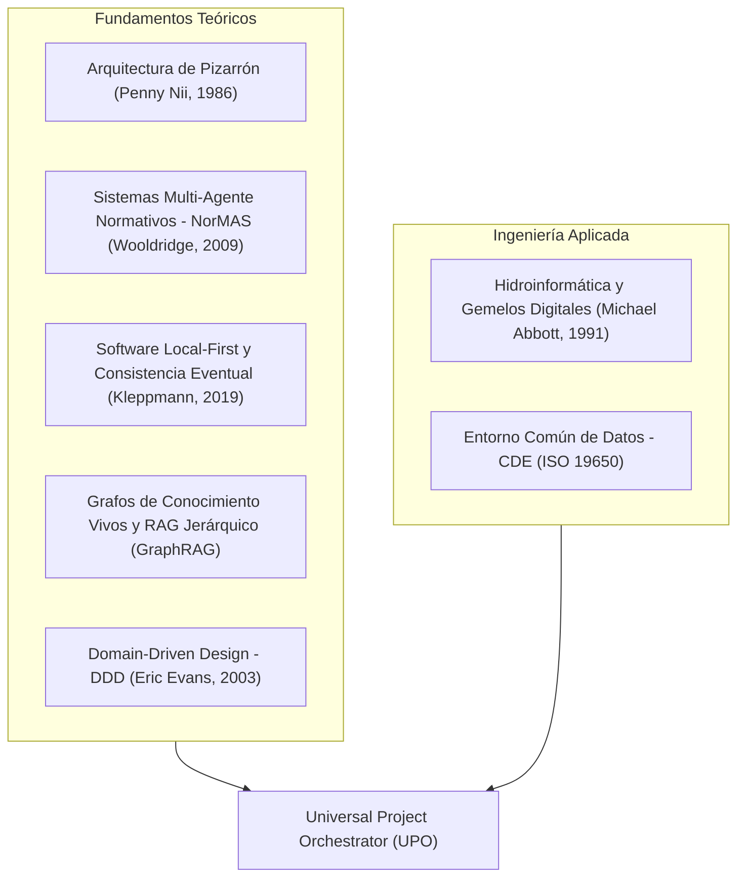

# Universal Project Orchestrator (UPO)

> Sistema operativo agéntico y meta-skill universal para la orquestación del ciclo de vida de proyectos, gobierno de sistemas multi-agente, economía estricta de tokens y ejecución desacoplada de dominios técnicos.

[](LICENSE)
[](https://modelcontextprotocol.io)
[](https://inkandswitch.com/local-first/)
[](#)

---

## 1. ¿Qué es Universal Project Orchestrator?

**Universal Project Orchestrator (UPO)** es una meta-skill y marco de trabajo metodológico diseñado para coordinar agentes de inteligencia artificial heterogéneos (Claude Code, Google Antigravity, OpenAI Codex, modelos locales en LM Studio) sobre entornos de trabajo distribuidos y multi-máquina.

A diferencia de los asistentes conversacionales estándar que operan en ventanas de chat efímeras con volcados masivos de contexto, UPO implementa una arquitectura transaccional donde los agentes operan como ingenieros especializados: adquieren cerrojos de exclusión mutua para evitar colisiones de archivos en almacenamiento sincronizado (Google Drive / LAN), leen quirúrgicamente la información mediante una pirámide de memoria jerárquica, delegan subtareas mediante el patrón **Superpowers**, ejecutan cálculos físicos deterministas mediante servidores **Model Context Protocol (MCP)** y sanitizan sus entregables eliminando huellas invisibles y muletillas de inteligencia artificial.

---

## 2. Fundamentación Teórica y Científica

El diseño de UPO no es una colección ad-hoc de scripts; se fundamenta formalmente en cinco áreas consolidadas de las Ciencias de la Computación y la Ingeniería:



### A. Arquitectura de Pizarrón (Blackboard Architecture)
* **Referencia formal:** Hearsay-II Project; Nii, H. P. (1986). *The Blackboard Model of Problem Solving*.
* **Aplicación en UPO:** El repositorio local unificado actúa como una memoria compartida (*blackboard*). Agentes autónomos con diferentes arquitecturas neuronales leen el estado del proyecto, publican avances parciales y respetan marcas de bloqueo sin necesidad de un acoplamiento directo entre ellos.

### B. Sistemas Multi-Agente Normativos (NorMAS)
* **Referencia formal:** Wooldridge, M. (2009). *An Introduction to MultiAgent Systems*; Boella, G., & van der Torre, L. (2004).
* **Aplicación en UPO:** Los agentes no se controlan con sugerencias informales, sino mediante contratos institucionales duros especificados en esquemas XML y reglas inviolables de gobernanza. Las reglas imponen restricciones duras: autores inmodificables, formatos canónicos y límites obligatorios.

### C. Software Local-First y Consistencia Distribuida
* **Referencia formal:** Kleppmann, M. et al. (2019). *Local-first software: you own your data, in spite of the cloud*.
* **Aplicación en UPO:** Los datos primarios residen en el sistema de archivos local en formatos transparentes (`.json`, `.xml`, `.md`, `.sqlite`). UPO resuelve las condiciones de carrera inherentes a la sincronización en la nube (conflictos tipo `archivo (1).md`) mediante cerrojos atómicos temporales y reemplazo transaccional en disco.

### D. Separación de Dominio y Generación Paramétrica (Domain-Driven Design)
* **Referencia formal:** Evans, E. (2003). *Domain-Driven Design: Tackling Complexity in the Heart of Software*.
* **Aplicación en UPO:** Queda estrictamente prohibido codificar parámetros técnicos numéricos (caudales, cotas, rugosidades, diámetros) directamente en el cuerpo de los informes. El parámetro vive como una única fuente de verdad en un archivo canónico estructurado (`DATOS_TECNICOS.json`), y las memorias técnicas en LaTeX o Markdown son vistas generadas automáticamente por compiladores deterministas.

### E. Hidroinformática y Gestión de Información en Infraestructura (ISO 19650)
* **Referencia formal:** Abbott, M. B. (1991). *Hydroinformatics: Information Technology and the Aquatic Environment*; Estándar ISO 19650 para CDE (*Common Data Environment*).
* **Aplicación en UPO:** Integración nativa entre el ciclo documental y los motores de cálculo hidráulico (Manning, Hazen-Williams, EPA-SWMM, EPANET/WNTR), permitiendo que la memoria de cálculo verifique automáticamente la normativa técnica nacional (como la Resolución 0330 de 2017 - RAS en Colombia).

---

## 3. Metodología Operativa en 5 Fases

Toda tarea gobernada por UPO sigue un ciclo de vida riguroso:

```
[1. Pre-vuelo y Bloqueo] ──> [2. Recuperación Quirúrgica] ──> [3. Despacho Superpowers]
                                                                        │
                                                                        ▼
[5. Auditoría Zero-AI y Cierre] <── [4. Ejecución Desacoplada de Dominio] ┘
```

### Fase 1: Pre-Vuelo y Exclusión Mutua (Mutex)
Antes de modificar archivos en un proyecto compartido:
1. Se audita la salud del directorio con `test-sync-health.ps1`, aislando duplicados de conflicto.
2. El agente solicita un cerrojo temporal mediante `agent_mutex.py acquire <recurso> --agent <id> --ttl 15`.
3. Si el recurso está tomado, la operación se suspende para prevenir escrituras concurrentes.

### Fase 2: Recuperación Quirúrgica de Contexto (Anti-Context Rot)
Para preservar la ventana de contexto y respetar el techo de 150 000 tokens por sesión:
* **Capa 1 (0 tokens de red):** Búsqueda local FTS5 en milisegundos con `search/cli.py`.
* **Capa 2 (~1 500 tokens):** Consulta relacional acotada en el grafo de conocimiento con `graphify query`.
* **Capa 3 (Lectura dirigida):** Lectura quirúrgica especificando `StartLine` y `EndLine`. Queda vetado volcar archivos enteros de más de 100 líneas al LLM.

### Fase 3: Despacho y Delegación Agéntica (Patrón Superpowers)
* Subtareas independientes (por ejemplo, auditar tres memorias de cálculo simultáneas o procesar capas vectoriales en QGIS) se delegan a subagentes paralelos con contextos limpios y aislados.
* Cada subagente recibe un prompt atómico: objetivo en una sola línea, insumos precisos y criterio verificable de parada.

### Fase 4: Ejecución Desacoplada de Dominio
* El agente lee o actualiza el modelo canónico estructurado (`DATOS_*.json`).
* Los cálculos se ejecutan a través de servidores MCP locales (`civil`, `matlab`, `qgis`) o scripts deterministas en Python.
* El informe técnico se renderiza paramétricamente a partir de plantillas oficiales en Markdown o LaTeX.

### Fase 5: Auditoría de Calidad, Sanitización Zero-AI y Cierre
* **Purga Zero-AI:** Se procesa el entregable con `turnitout_humanizer.py` para erradicar caracteres invisibles Unicode (*zero-width*) y clichés de inteligencia artificial.
* **Control estilométrico:** Verificación del estándar AHOH (prohibición estricta de rayas largas y del símbolo de sección; voz impersonal con "se").
* **Liberación:** Registro del evento en `.brain/events/events.jsonl` y liberación del cerrojo con `agent_mutex.py release`.

---

## 4. Orquestación del Ecosistema: Reglas, Skills, Mods y Conectores

UPO no reemplaza las herramientas existentes; las organiza en una jerarquía coherente:

```
┌────────────────────────────────────────────────────────────────────────┐
│                      UNIVERSAL PROJECT ORCHESTRATOR                    │
├────────────────────────────────┬───────────────────────────────────────┤
│ GOBERNANZA Y REGLAS            │ PROTOCOLOS Y CONECTORES (MCP)         │
│ - REGLAS_GOBERNANZA_MI_UNIDAD  │ - MCP civil (RAS 0330, pérdidas HW)   │
│ - ESTANDAR_GESTION_TOKENS      │ - MCP matlab (Simulink, scripts .m)   │
│ - ESTANDAR_ESTILO_AHOH         │ - MCP qgis (geoprocesamiento espacial)│
├────────────────────────────────┼───────────────────────────────────────┤
│ PLUGINS Y MODS DEL ENTORNO     │ BIBLIOTECA DE HABILIDADES (86 SKILLS) │
│ - watermarks-remover           │ - writing-plans / executing-plans     │
│ - ponytail (lazy senior dev)   │ - dispatching-parallel-agents         │
│ - token-meter                  │ - docx / xlsx / latex-equation-hud    │
│ - image-preview (HUD flotante) │ - systematic-debugging                │
└────────────────────────────────┴───────────────────────────────────────┘
```

---

## 5. Caso de Aplicación Real: Ingeniería Civil e Hidroinformática

El repositorio incluye un caso de estudio de ingeniería real validado en producción:

* **Proyecto:** Estudio de Vertimiento PTAR Puerto Buenavista (Cartagena de Indias).
* **Modelo Canónico:** [`examples/civil_engineering/DATOS_TECNICOS.json`](examples/civil_engineering/DATOS_TECNICOS.json), conteniendo geometría del canal artificial Yara ($b = 1,20$ m, $z = 0,50$, $S_0 = 0,18$ %, $n = 0,015$), balance de caudales y calidad esperada de aguas residuales domésticas tratadas.
* **Motor Determinista:** [`core/generar_memoria_tecnica.py`](core/generar_memoria_tecnica.py), resolviendo el tirante normal ($y_n = 0,063$ m) por el método de Newton-Raphson y verificando velocidades de autolimpieza y límites de erosión.
* **Entregable Generado:** [`examples/civil_engineering/MEMORIA_CALCULO_HIDRAULICO_VERTIMIENTO.md`](examples/civil_engineering/MEMORIA_CALCULO_HIDRAULICO_VERTIMIENTO.md), con tablas normativas y discretización espacial para el modelo de calidad de agua QUAL2K.

---

## 6. Estructura del Repositorio

```
universal-project-orchestrator/
├── SKILL.md                 # Definición canónica de la meta-skill para agentes
├── LICENSE                  # Licencia MIT
├── README.md                # Memoria técnica y guía integral
├── core/                    # Módulos del núcleo ejecutable
│   ├── agent_mutex.py       # Exclusión mutua, cerrojos temporales y bus JSONL
│   ├── mcp_civil_server.py  # Servidor MCP y CLI de cálculo hidráulico y RAS 0330
│   ├── generar_memoria_tecnica.py # Compilador paramétrico de memorias de cálculo
│   └── test-sync-health.ps1 # Auditor de sincronización y detección de conflictos
├── schemas/                 # Esquemas formales de validación
│   ├── workflow.json        # Máquina de estados y compuertas de calidad
│   └── adapter_schema.json  # Esquema JSON Schema para enchufar nuevos dominios
└── examples/                # Casos prácticos de aplicación
    └── civil_engineering/   # Estudio de vertimiento de Puerto Buenavista
        ├── DATOS_TECNICOS.json
        └── MEMORIA_CALCULO_HIDRAULICO_VERTIMIENTO.md
```

---

## 7. Instalación y Uso Rápido

### Como Herramienta de Línea de Comandos (CLI):
```bash
# 1. Adquirir un cerrojo exclusivo para un proyecto
python core/agent_mutex.py acquire "PROYECTO_ALPHA" --agent "MiAgente" --ttl 15

# 2. Ejecutar una verificación hidráulica normativa
python core/mcp_civil_server.py --tool verificar_criterio_ras --args "{'diametro_mm': 200, 'pendiente_m_m': 0.008, 'caudal_l_s': 25.0}"

# 3. Generar una memoria paramétrica a partir de datos estructurados
python core/generar_memoria_tecnica.py --project "examples/civil_engineering"

# 4. Liberar el cerrojo
python core/agent_mutex.py release "PROYECTO_ALPHA" --agent "MiAgente"
```

### Como Skill para Agentes (Claude Code, Antigravity, Codex):
Copiar la carpeta a su directorio de habilidades o crear un enlace simbólico (*junction*):
```powershell
New-Item -ItemType Junction -Path "$env:USERPROFILE\.agents\skills\universal-project-orchestrator" -Target "C:\ruta\a\universal-project-orchestrator"
```

---

## 8. Autor y Licencia

* **Autor:** Ing. Aiken H. Ortega-Heredia, M.Sc.
* **Afiliación:** Universitat Politècnica de València (UPV) / Institución Universitaria Mayor de Cartagena (UMayor).
* **Licencia:** Este proyecto se distribuye bajo los términos de la [Licencia MIT](LICENSE).
